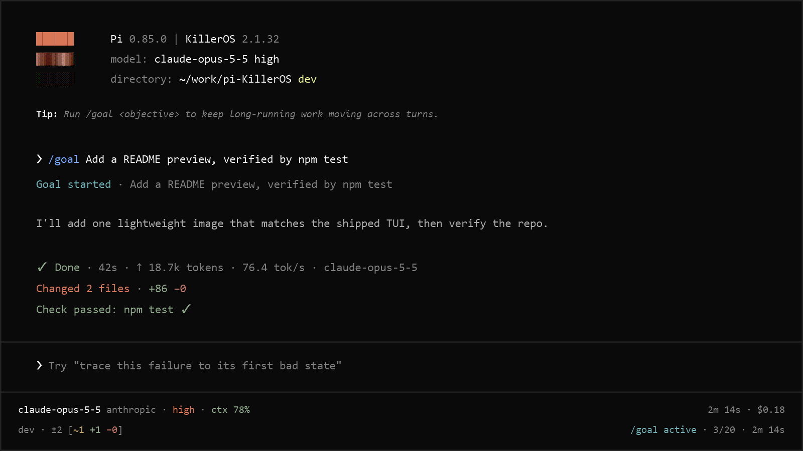

# KillerOS: Pi coding agent workflow toolkit

[](https://www.npmjs.com/package/killeros)
[](https://github.com/KyrosHendrix/pi-KillerOS/actions/workflows/ci.yml?query=branch%3Amain)
[](LICENSE)
[](#install)
[](https://hub.xerj.org/contributors/KyrosHendrix)

**Start a fresh session without starting the explanation over.**

A Windows terminal UI for the [Pi coding agent](https://github.com/earendil-works/pi), with session handoff, context management, OpenAI fast mode, and persistent goals.



## Your workflow, in the terminal

- **Session handoff.** `/handoff [focus]` creates a linked session with a continuation summary. You decide when to continue.
- **Context control.** `/auto-compact 20` triggers proactive compaction at 20% tokens remaining. The default is 15%.
- **OpenAI fast mode.** `/codex-fast` toggles priority-service requests for eligible OpenAI models without changing sampling settings.
- **Persistent goals.** `/goal <objective>` continues work across turns, compaction, and reloads. Pause, edit, or resume it.
- **Session visibility.** The footer shows model, remaining context, and goal status. Settled task receipts show duration and token usage.
- **Interactive questions.** The question tool offers single-select and multi-select answers inside the terminal.

## Install

KillerOS supports Windows only. Requires native Windows Node.js 26.13.0 or later within Node 26 and Pi 1.4.0 or later below 2.0.0. Users on older Node or Pi versions must upgrade.

```bash
pi install npm:killeros
pi
```

Run `/login` if needed, then start a conversation.

<details>
<summary>GitHub install and version pinning</summary>

- GitHub: `pi install git:github.com/KyrosHendrix/pi-KillerOS`.
- Pin a version: `npm:killeros@3.0.8` or `git:github.com/KyrosHendrix/pi-KillerOS@v3.0.8`.
- Add `-l` for a project-only install.

</details>

## Try it

Start a linked session from an idle saved conversation with no active goal:

```text
/handoff Focus next on implementing the agreed plan
```

Or give the agent a checkable goal:

```text
/goal Create `./summary.md` describing this repository's entry points, verified against the source files
```

<details>
<summary>All commands</summary>

```text
/handoff [focus]          Carry context into a linked session
/codex-fast [status]      Toggle or report priority service
/auto-compact [status|on|off|<percent>]
/goal                    View the current goal
/goal <objective>        Set an objective
/goal edit <objective>   Update an active or paused goal
/goal pause              Stop automatic continuation
/goal resume             Resume automatic continuation
/goal clear              Remove the current goal
/notification            Configure the completion sound
/new                     Start a new session using Pi's native command
/exit                    Quit Pi
```

</details>

## Before you run

- Model requests cost money. Goals can make repeated requests; OpenAI priority service can cost more and is not guaranteed.
- Review results and handoff summaries. Secret detection is incomplete; source context reaches your configured provider.
- Extensions run with your permissions. Review project hooks before granting trust.
- Questions require TUI mode. RPC supports goals and proactive compaction. Print and JSON modes support neither.

<details>
<summary>Goal limits, handoff behavior, and compaction</summary>

- Goals get 20 turns. Resume an exhausted goal to grant another 20. Work stops on completion, a blocker, or a pause.
- For supported single-file objectives such as the quoted `Create` example above, KillerOS requires the file to exist, or its content to change if it already existed. Multiple distinct file targets do not receive single-file proof. This does not prove every natural-language requirement. Saved goals without file proof keep that contract until you edit or replace the objective.
- `/handoff` requires an idle saved session with no active goal. It saves a structured continuation summary, not the full transcript. The current saved objective and status become context in the linked child; no goal or agent turn starts automatically.
- Missing or changed goal details, committed navigation, reload, or session replacement invalidate a pending handoff. Cancelled and no-op navigation preserve valid work.
- Handoff rejects recognized credentials in generated output, including password assignments in Markdown blockquotes and tables. It cannot detect every secret or redact source context before it reaches your provider.
- Compaction triggers by default at 15% tokens remaining. Turning KillerOS compaction off doesn't disable Pi's own compaction.
- Fast mode's footer label doesn't confirm OpenAI accepted the priority tier or guarantee faster responses.

</details>

<details>
<summary>Pi compatibility and settings</summary>

- KillerOS leaves Pi's `tuiMode` and `quietStartup` preferences unchanged. Pi defaults to fullscreen. Use `--tui-mode regular` or `"tuiMode": "regular"` for terminal-owned scrollback. Your keybindings still apply.
- Settings live in `%USERPROFILE%\.pi\agent\killeros.json`. The compaction defaults are `"autoCompaction": { "enabled": true, "percentRemaining": 15 }`. Fast mode isn't persisted.
- Completion sounds are off by default. The tab-title indicator requires a Nerd Font.
- Pi's native `--tools` and `--exclude-tools` support `*` patterns. Quote patterns such as `"killeros_*"` so the shell does not expand them. An explicit allowlist must include `question` for questions and permit `killeros_goal_update` for goals. Excluding the goal tool pauses goals. Use `--exclude-tools` rather than `-name` modifiers. See [tool selection](https://github.com/earendil-works/pi/blob/main/packages/coding-agent/docs/cli.md#tools).
- In Pi codemode, `tools.read()` returns an image block for images that you can pass to `image()`. See [codemode](https://github.com/earendil-works/pi/blob/main/packages/coding-agent/docs/codemode.md#call-tools).
- Use `/thinking` and `samplingParamsByThinkingLevel` for [native sampling](https://github.com/earendil-works/pi/blob/main/packages/coding-agent/docs/models.md#configure-sampling-by-thinking-level). Use `.pi/mcp.json` for [trusted project MCP overrides](https://github.com/earendil-works/pi/blob/main/packages/coding-agent/docs/mcp.md#configure-servers).
- A nonempty `--tools` list with no `mcp__` entry preserves MCP tool availability. For example, `--tools codemode` does not disable MCP connections. Use `--no-mcp` to disable MCP connections. See [MCP tool exposure](https://github.com/earendil-works/pi/blob/main/packages/coding-agent/docs/mcp.md#control-tool-exposure).

</details>

<details>
<summary>Contributing and releases</summary>

## Contributing

Use Node.js 26.13.0, pinned in `.node-version`. Install dependencies with `npm ci --ignore-scripts --no-audit --no-fund`. Run the checkout with `npx pi -e .`, with any installed copy disabled. Run `npm run check` and `npm run test:changed`, which runs the test files that cover your changes. CI runs the full suite, `npm test`, across four runners in about 5 minutes. Locally it takes about 10 minutes and runs at most four test files concurrently to bound child-process load. There is no build step.

Automatic pre-merge CI requires a pull request, including a draft pull request. Open a draft PR for feedback or run the CI workflow manually. Standalone pushes to `dev` do not start automatic CI. Run local checks before pushing. CI also runs on pushes to `main` and on the weekly schedule.

### Release process

Prepare releases on `dev`, update package versions and changelog, and open a PR into `main`. Wait for required checks and review, then use a merge commit. Releases go through CI on `main`; do not push version tags manually. Wait for the automated sync back to `dev` before advancing it.

</details>

[Report a bug](https://github.com/KyrosHendrix/pi-KillerOS/issues) · [Changelog](CHANGELOG.md) · [MIT license](LICENSE)
