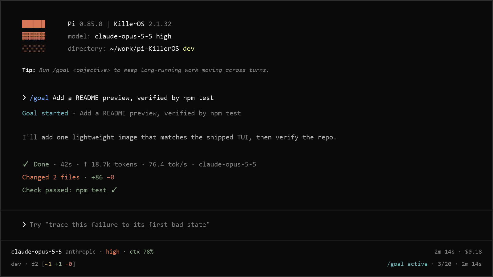

# KillerOS

## A custom terminal UI and goal runner for the Pi coding agent

KillerOS is a TypeScript extension for the [Pi coding agent](https://github.com/earendil-works/pi). It replaces Pi's stock terminal UI and lets the agent work toward an objective across turns and context compaction. You can pause or resume a goal, carry context into a fresh session, and answer structured questions without leaving the terminal.

The UI has a dark theme with coral accents, a multiline editor with slash-command completion, and a footer for model, context, and goal state. The startup masthead shows versions, model, working directory, and Git branch. Settled task receipts show duration and token usage. Completion sounds are optional.



- [Install and start](#install-and-start)
- [Use KillerOS](#use-killeros)
- [Configuration and Pi compatibility](#configuration-and-pi-compatibility)
- [Set up for development](#set-up-for-development)
- [Contribution and release expectations](#contribution-and-release-expectations)
- [Known issues and limits](#known-issues-and-limits)
- [Security](#security)

## Install and start

### Requirements

- Windows with native Windows Node.js
- Node.js 22.19.0+
- Pi 1.3.0 or later below 2.0.0
- An interactive TUI session for the custom header, editor, footer, and questions

KillerOS supports Windows only. Linux, macOS, and WSL running Linux Node.js are not supported. npm rejects installation on other operating systems, and KillerOS rejects activation outside Windows. Users on older Pi versions must upgrade.

Pi extensions run with your user permissions. Review the source before installing globally. See [Security](#security) before trusting project hooks. Goal work sends model requests and can incur provider charges.

1. [Install Pi](https://github.com/earendil-works/pi#getting-started) if you do not already have it.
2. Install KillerOS:

   ```bash
   pi install npm:killeros
   ```

3. Restart Pi in the project you want to work on:

   ```bash
   pi
   ```

4. If you have not configured a provider, run `/login` in Pi. Then enter an objective:

   ```text
   /goal Create `./summary.md` describing this repository's entry points, verified against the source files
   ```

The goal appears in the footer. The agent works until it records completion, reports a blocker, or pauses. On completion, `summary.md` contains the repository summary. A new goal has a 20-turn limit. Use `/goal` to inspect it and `/goal resume` to grant another 20 turns when the limit is exhausted.

You can also install from GitHub:

```bash
pi install git:github.com/KyrosHendrix/pi-KillerOS
```

To pin a release, use `npm:killeros@3.0.8` or append a Git tag such as `@v3.0.8` to the Git source. Add `-l` to install only for the current project. Pi loads project packages only after you grant project trust.

### Commands

```text
/goal                     View the current goal
/goal <objective>         Set an objective
/goal edit <objective>    Update the objective without resetting the goal
/goal pause               Stop automatic continuation
/goal resume              Resume automatic continuation
/goal clear               Remove the current goal
/codex-fast [status]      Toggle or report fast mode
/auto-compact [status|on|off|<percent>]
                          Inspect or change automatic compaction
/notification             Configure the completion sound
/handoff [focus]          Start a linked session with continuation context
/clear                    Start a new session after confirmation
/exit                     Quit Pi gracefully
```

## Use KillerOS

### Goals and proof

Include the result you want and how the agent can verify it:

```text
/goal Reduce p95 checkout latency below 120 ms, verified by the checkout benchmark, while keeping the correctness suite green
```

KillerOS cannot independently prove arbitrary objectives from prose. The assistant must check the whole objective before reporting completion.

A directly quoted, path-shaped file target adds silent file proof. KillerOS captures its baseline at goal start and accepts completion only after the file is created or changed. For an extensionless relative file, use an explicit path such as `./summary` or `.\summary`. Bare quoted prose uses model-reported completion. File proof verifies the deliverable, not every acceptance criterion in the objective.

Editing a goal updates it in place without resetting its turn count, active clock, or token accounting. The change applies from the next turn while an in-flight turn finishes under the old text, so every later goal turn and ordinary request uses the new objective. A quoted file target is re-baselined for the new objective, and completion proof then measures change since the edit. `edit` is a command only for an active or paused goal; otherwise the text is an ordinary objective, so `/goal Edit the file` still starts a goal.

Each goal turn must record a decision through `killeros_goal_update`:

- `continue`, with evidence and one next action.
- `complete`, after verification.
- A blocker decision that stops automatic work.

An ordinary response does not authorize another turn. Missing decisions, repeated continuation reports, and an unavailable goal tool pause the goal. New goals pause after 20 turns without warning. An explicit `/goal resume` on an exhausted goal grants another 20. Restored goals retain their saved limit.

Goals survive compaction, reloads, and session-tree navigation. Compaction recovery never grants turns. Recovery within the same turn requires an actual interruption. Successful or skipped compaction cannot restart a stopped goal without an accepted decision. A request that completes or blocks a goal stays goal-owned through settlement, so automatic compaction cannot restart it as ordinary work.

A blocked goal stays stopped. During a later ordinary TUI or RPC request in a saved session, the assistant can complete the same unchanged objective with current evidence. This path accepts only `complete`. It preserves the original file baseline and records `file` proof or `model-reported` completion. It does not resume automatic work, grant turns, restart the active clock, or require `/goal clear`. Failed proof or a response without a completion decision leaves the goal blocked. Paused goals still require explicit user controls.

Completed goals leave the footer but remain available through `/goal` and session history.

Pending goal commands do not replace newer state. If committed navigation changes the branch or another mutation changes the goal during confirmation, idle waiting, or file-baseline reading, KillerOS discards the pending mutation. Cancelled navigation preserves valid pending commands. Discarding a stale replacement preserves the surviving goal's authorized continuation.

### Context and automatic compaction

Compaction triggers by default at 15% tokens remaining. Use `/auto-compact status` to inspect the effective KillerOS preference, `on` or `off` to toggle it, or an integer from 0 through 100 to set the threshold:

```text
/auto-compact 20
/auto-compact off
```

Turning off KillerOS automatic compaction does not turn off Pi's own automatic compaction. A threshold of 0 does not disable Pi's token reserve. Later ordinary requests can still use compaction continuation.

The footer shows remaining context as `ctx 85% (849K/1M)`. The percentage and numerator both mean remaining. The denominator is Pi's configured context capacity, not an independently verified provider limit. Counts use decimal K and M units and round down.

On narrow terminals, the footer drops the remaining count, then capacity, before dropping the model name and percentage. Unknown usage shows only capacity. Unknown capacity shows `ctx —%` without an invented limit. Usage estimates can be unavailable after compaction.

At the rounded 15% remaining warning threshold, the footer suggests `/compact` only when KillerOS automatic compaction is known to be off. Successful `/auto-compact` changes refresh the hint immediately. Turn-end settings reads also refresh it, including changes made by another process. The warning stays at 15% regardless of the automatic threshold. Settings-read errors omit the hint.

### Fast mode and billing

Priority service can affect billing. OpenAI controls account and model eligibility, the accepted service tier, and charges. A ChatGPT subscription does not guarantee accepted or free priority service.

Fast mode is off by default. `/codex-fast` toggles it. `/codex-fast status` reports the preference without changing it. The preference lasts for the current Pi process, including model switches and extension reloads. KillerOS does not save it between processes. The command and notifications retain their legacy Codex wording.

Fast mode applies to legacy `openai-codex` requests and native requests that meet all these conditions:

- The selected model uses provider `openai` and API `openai-responses`.
- Its base URL is `https://api.openai.com/v1`, with an optional trailing slash.
- The request payload names the selected model's exact ID.

API-key and ChatGPT subscription authentication follow the same rule. Custom endpoints, Azure, other APIs, and ambiguous native requests pass through unchanged.

When enabled, fast mode overrides an eligible request's service tier with `priority` and preserves sampling and other payload fields. When disabled, it leaves the request unchanged. The footer's `fast` label means the preference applies to the selected model, not that OpenAI accepted priority service. KillerOS leaves provider errors and retries to Pi. It does not silently retry with a different tier.

### Questions

The `question` tool supports single-select and multi-select answers. It asks one question per invocation and requires TUI mode.

In single-select mode, choosing a numbered option submits the answer. In multi-select mode, choosing an option toggles its selection and reopens the selector. Choose **Submit answers** when finished. KillerOS checks the requested minimum and maximum. It returns predefined answers in their original order, followed by an optional custom answer.

Choose **Custom answer** to open Pi's text input. Multi-select allows one custom answer, which you can edit or remove. Blank answers do not submit. Custom answers accept up to 4,000 Unicode characters. Cancelling custom input returns to the selector without losing selections.

**More actions** lets you filter options, clear a filter, review the full question and option details, or select a recent custom answer. Filters match labels and descriptions without losing hidden selections. Filter queries accept up to 4,000 Unicode characters and 16,000 UTF-8 bytes.

Option summaries have bounded descriptions. Review displays full descriptions and proposal previews as paged plain text, including Markdown source. Use **Next page**, **Previous page**, and **Back** to navigate. Long option lists and recent-answer history also use pages. History holds at most 100 distinct answers and 64 KiB of text in the current session. Session changes clear it.

Questions use Pi's native dialog keybindings and text editing. Multi-select uses successive selection steps, not the former space-toggle and slash-filter shortcuts. Resizing preserves selections and text-input drafts.

Cancelling the main selector discards unsubmitted answers. Cancelling a filter, history, or review step returns to the selector. Agent cancellation or session invalidation closes the question and prevents another step. Dialog steps stay within one tool execution. They do not send model requests or grant goal turns.

### Handoff

`/handoff [focus]` creates a fresh linked session with visible continuation context. It saves that context as a user message before reporting success, so you can exit and resume immediately without another prompt. Creating the handoff does not start an agent turn.

The summary output limit is 8192 tokens by default. Raise `handoffMaxTokens` if long sessions truncate it. Handoff validation rejects recognized credentials before creating the destination session. See [Security](#security) for the limits of that check.

### Receipts, sounds, and Git status

Receipts and completion sounds wait for final `agent_settled`, including across provider retries. Sounds are off by default. Configure them with `/notification` in TUI mode. The tab-title indicator requires a Nerd Font.

Final request cancellation records `Stopped` and suppresses the sound even if the last assistant response ended normally. The receipt retains recorded changes and checks. Cancellation stops goal continuation and provider retry work. Cancelling pending compaction prevents its recovery.

Session replacement, reload, and committed tree navigation discard unfinished receipts. Late results cannot write or notify through the old session context or attach to another branch. Cancelled navigation preserves pending receipts.

Failed Git reads retain the footer's last successful file counts and mark task changes unavailable. KillerOS does not treat a failed scan as an empty repository. Passive scans compare content without executing repository filters or repository-owned Git shims.

## Configuration and Pi compatibility

### KillerOS settings

KillerOS activates its packaged `killeros` theme on TUI start. It stores settings in `killeros.json` in Pi's global agent directory, normally `%USERPROFILE%\.pi\agent\killeros.json`:

```json
{
	"autoCompaction": {
		"enabled": true,
		"percentRemaining": 15
	},
	"handoffMaxTokens": 8192
}
```

Concurrent `/auto-compact` commands preserve independent changes to the enabled flag and threshold, along with unrelated settings. Malformed settings and failed writes report errors without claiming success or replacing the original file.

Trusted projects can use lifecycle hooks for `tool_call`, `tool_result`, and `agent_settled` in `.pi/killeros-hooks.json`. KillerOS also loads `AGENTS.local.md` for trusted projects. Review these files before granting trust.

Pi runs `before_agent_start` for user prompts and extension-triggered requests. KillerOS applies trusted personal instructions through that shared setup, including goal and compaction continuations, without copying them into each continuation message.

### Supported modes and navigation

Pi defaults to fullscreen. Use `--tui-mode regular` for one invocation or set `"tuiMode": "regular"` in [Pi settings](https://github.com/earendil-works/pi/blob/main/packages/coding-agent/docs/settings.md#terminal-and-display) to restore terminal-owned scrollback. KillerOS leaves Pi's `tuiMode` and `quietStartup` preferences unchanged.

| Mode | Support |
| --- | --- |
| TUI | Custom UI, questions, goals, proactive compaction, sounds, and title indicator |
| RPC | Goals and proactive compaction, without TUI components, sounds, or title indicator |
| Print or JSON | No interactive questions, `/goal`, or proactive compaction |

With Pi's default [keybindings](https://github.com/earendil-works/pi/blob/main/packages/coding-agent/docs/keybindings.md#fullscreen), `Home` and `End` move within the current editor line. In fullscreen mode, `Ctrl+Home` and `Ctrl+End` scroll to the transcript's beginning or end without moving the editor cursor. KillerOS inherits these bindings and preserves user overrides.

Pi reports program status through OSC 7501 in supported terminals. Each question step reports `blocked` and restores the previous status after an answer, cancellation, or abort. Native confirmation dialogs do the same. `PI_PROGRAM_STATUS=1` forces reporting and `PI_PROGRAM_STATUS=0` disables it. KillerOS preserves the preference and uses Pi's native reporting. See [program status](https://github.com/earendil-works/pi/blob/v1.2.0/packages/coding-agent/docs/terminal-setup.md#program-status).

### Tool selection and codemode

`question` and the active `killeros_goal_update` tool are sequential and use Pi's `model-only` exposure. Pi declares them directly to the model with codemode disabled or enabled in `on` or `only` mode. Scripts and other tools cannot call them through `ctx.executeTool()`.

The goal tool is active for active goals. During a later ordinary request, it can also be active for completion only of the same saved blocked goal. It is inactive outside those cases. A direct RPC question call fails with `The question tool requires interactive TUI mode`. KillerOS does not enable or configure codemode.

Pi's native `--tools` and `--exclude-tools` support `*` patterns. Quote patterns such as `"killeros_*"` so the shell does not expand them. An explicit allowlist must include `question` for interactive questions and permit `killeros_goal_update` for goals. Tool selection does not make questions usable outside TUI mode.

Excluding the goal tool pauses goals that are active before any model request. A later ordinary request with a blocked goal still runs, but cannot record completion if the tool is excluded. See [Pi tool selection](https://github.com/earendil-works/pi/blob/main/packages/coding-agent/docs/cli.md#tools).

Pi accepts lists containing only exact `+name` and `-name` entries to change the default selection:

```bash
pi --tools +codemode
pi --tools +codemode,-write
```

Plain allowlists replace the selection. Pi rejects mixed lists such as `read,+codemode` and modifier patterns such as `-killeros_*`. Use `--exclude-tools "killeros_*"` for wildcard exclusions.

A `-name` modifier does not reliably prevent an extension tool from activating on registration or reload. To exclude the goal tool, use:

```bash
pi --exclude-tools killeros_goal_update
```

KillerOS delegates selection to Pi. It does not parse or repair native CLI filters.

In Pi codemode, `tools.read()` on an image returns an image block that you can pass to native `image()`. See [codemode tool calls](https://github.com/earendil-works/pi/blob/main/packages/coding-agent/docs/codemode.md#call-tools).

Pi's `image()` also saves images to temporary files and returns their paths for later turns to copy or move. On Windows, access follows inherited filesystem ACLs. See [image generation](https://github.com/earendil-works/pi/blob/main/packages/coding-agent/docs/codemode.md#generate-images).

### Reasoning, sampling, and Azure

Use Pi's native `/thinking` selector for reasoning levels. Pi supports per-level sampling through `samplingParamsByThinkingLevel` in `models.json`. A model entry can contain:

```json
{
	"samplingParams": { "temperature": 1.0, "top_p": 0.95 },
	"samplingParamsByThinkingLevel": {
		"off": { "temperature": 0.7, "top_p": 0.8 },
		"high": { "temperature": 0.6 }
	}
}
```

Configure only parameters your endpoint accepts. These settings apply to `openai-completions`, `openai-responses`, and `azure-openai-responses`, not legacy `openai-codex`. Missing levels inherit model defaults. Request-level sampling parameters take precedence. `/codex-fast` preserves sampling when it adds the priority tier. See [sampling configuration](https://github.com/earendil-works/pi/blob/main/packages/coding-agent/docs/models.md#configure-sampling-by-thinking-level) for the full format and merge rules.

Pi's Azure provider is `azure`. It supports Azure Foundry Chat Completions, including `azure/deepseek-v4-pro`. If you still use the old `azure-openai-responses` provider key:

1. Rename it to `azure` in `auth.json`, or run `/login azure` again.
2. Apply the same rename in `models.json`.
3. Update `defaultProvider`, `enabledModels` patterns, and `modelThinkingLevels` keys in `settings.json`.

The Responses API identifier remains `azure-openai-responses`. Foundry Chat Completions uses `openai-completions`. The `AZURE_OPENAI_*` environment variables are unchanged. Old Azure sessions fall back to another model on resume and lose prompt-cache reuse. KillerOS does not migrate credentials or Pi settings. See [Azure configuration](https://github.com/earendil-works/pi/blob/main/packages/coding-agent/docs/providers.md#azure-openai).

### MCP settings

Use Pi's `/mcp` command and `.pi/mcp.json` to enable, disable, or change the exposure of a user-level MCP server for a trusted project without copying credentials. KillerOS does not manage MCP configuration. See [project MCP overrides](https://github.com/earendil-works/pi/blob/main/packages/coding-agent/docs/mcp.md#configure-servers).

In Pi, a nonempty `--tools` list with no `mcp__` entry preserves MCP tool availability according to server exposure. For example, `--tools codemode` does not disable MCP connections or remove their tools. Use `--no-mcp` to disable MCP connections through Pi's built-in support for one run. Explicit MCP selection and exclusion remain Pi's responsibility. See [MCP tool exposure](https://github.com/earendil-works/pi/blob/main/packages/coding-agent/docs/mcp.md#control-tool-exposure).

## Set up for development

Clone the repository and install its pinned development dependencies:

```bash
git clone https://github.com/KyrosHendrix/pi-KillerOS.git
cd pi-KillerOS
npm ci --ignore-scripts --no-audit --no-fund
```

Run the local package for one Pi invocation:

```bash
npx pi -e .
```

Disable any installed copy of KillerOS for that invocation to avoid loading it alongside the checkout. Restart Pi or use `/reload` after edits.

There is no build step. The project uses strict TypeScript, and Node's built-in test runner executes the `.ts` tests directly:

```bash
npm run check
npm test
```

`check` runs TypeScript without emitting files, then ESLint. For README or changelog-only changes, run the repository contracts:

```bash
node --test --test-force-exit --experimental-strip-types test/RepositoryContracts.test.ts
```

The default suite is authoritative. To run the installed CLI and native-terminal scenarios without forced exit:

```bash
node --test --experimental-strip-types --test-name-pattern="installed Pi CLI|installed Pi terminal|terminal driver reports|RPC driver controls" test/PiExtensionContract.test.ts test/PiTerminalControls.test.ts test/PiRpcControls.test.ts
node --test --experimental-strip-types test/PiStartup.test.ts
```

Development dependencies and the minimum supported Pi version are 1.3.0. All CI and release jobs run on Windows. CI checks the Node.js floor and current LTS, plus the minimum and latest compatible Pi releases. Compatibility installs match Pi's AI, TUI, and TypeBox dependencies and leave the tracked manifest and lockfile unchanged. Repository contracts derive Pi version expectations from the current package requirements. Required jobs repeat startup lifecycle checks and installed CLI and terminal pilots five times without forced exit. Startup checks cover both trusted and untrusted projects through goal requests, cancellation, reload, and ordinary compaction continuations. Both Pi compatibility jobs repeat saved-tool restoration five times. The latest-Pi job also repeats cancellation lifecycle checks five times. Each job runs the full default suite once.

Real-CLI print and JSON scenarios verify question and goal rejection, project trust, and the absence of proactive compaction. Saved-tool restoration checks resume with native tool modifiers, completed goals, reload, explicit exclusions, and model-only decisions.

CLI, terminal, process-control, and Git branch-isolation failures include nested errors in the test output and save a bounded `failure.txt` in the retained fixture directory. Failed CI jobs upload only these reports as `test-failures-*` artifacts, retained for seven days. Successful scenarios create no reports. A passing rerun does not establish the cause of an intermittent failure.

## Contribution and release expectations

Run `npm run check` and `npm test` before submitting code changes. Changes to commands, configuration, requirements, or mode behavior also need README updates. Record completed changes to shipped behavior, supported workflows, public documentation, or build, test, and release guarantees under `[Unreleased]` in [CHANGELOG.md](CHANGELOG.md). Do not bump the version unless preparing a release.

### Adopt a Pi update

Check every stable Pi release, including patches, before adopting it:

1. Review its release notes, installed documentation, exported APIs, and the KillerOS behavior it affects.
2. Install the exact candidate with its matching AI, TUI, and TypeBox dependencies without changing tracked package files. Run the checks above on Windows at the Node.js floor and current LTS, including the lifecycle repetitions without forced exit.
3. If verification succeeds, make that release the new minimum. Update the Pi peer minimums, exact development pins, lockfile, README requirements, CI targets, and Unreleased notes together. Run a fresh `npm ci`, then repeat verification on the final change.
4. Confirm the required CI matrix on the final commit. Record the source revision, exact resolved package versions, operating system, Node version, commands, results, and skips. Leave a failed or incompletely checked candidate unadopted.

A peer range accepting a version is not executed verification. Report expected API compatibility separately from exact-version checks that ran. Do not add older-Pi compatibility branches or describe untested future releases as verified. Adoption does not bump KillerOS's release version or authorize publication.

### Release process

1. Prepare the release on `dev`. Update `package.json` and both root versions in `package-lock.json`. Update this README's pinned release examples. Move completed changelog entries into a dated version section below `[Unreleased]`.
2. Run `npm run check` and `npm test`. Commit and push to `dev`, then open a pull request into `main`. Push later fixes to the same PR so CI reruns.
3. Wait for every required check, including CodeQL and dependency review. Resolve review conversations and bring the PR up to date with `main`.
4. Merge with **Create a merge commit**. Squash and rebase merging are disabled because the automated `main`-to-`dev` sync requires shared ancestry. Do not advance `dev` until the sync finishes.
5. Check the `main` CI run and the following Release run. Successful CI on the current `main` commit triggers npm publication with provenance, creates the GitHub release, and fast-forwards `dev` to the released commit. A green PR alone does not publish.

Releases go through CI on `main`; do not push version tags manually. `main` requires pull requests and required CI checks, including for administrators. Force pushes and branch deletion are blocked.

The release workflow publishes the source directory with `npm publish . --ignore-scripts=false`. At that boundary, `prepublishOnly` invokes the release validator once, even if an inherited npm setting disables scripts. Validation failure stops publication and release creation. The workflow also checks the verified commit, provenance, version, tag, and release notes.

The prepublish guard rejects ordinary direct publication, but does not prove GitHub authorization. Disabling scripts or publishing a tarball bypasses it. Configure npm's trusted publisher for `release.yml`, require two-factor authentication and disallow tokens in package publishing access, and revoke unused publish tokens. Maintainers can still publish interactively with 2FA, so workflow-only publication also depends on maintainer policy.

### Required-check maintenance

Pi compatibility checks have stable names, `Pi compatibility (minimum)` and `Pi compatibility (latest)`, independent of tested versions. When adopting those names, confirm both passed on the release PR's exact head commit. Replace only the old versioned Pi requirements. Preserve their GitHub Actions app bindings and every other protection.

`Quality (Node 22.19.0)` validates release metadata before the full suite and tests the publication lifecycle with the release workflow's pinned npm CLI in an isolated installation. The packed-package Pi test checks the archive's entry point, README, changelog, theme, package name, and current version before activation and reload. Those assertions run across the Windows Node and Pi compatibility matrix.

`Package smoke test` remains during the required-check migration. Before removing its requirement:

1. Land the replacement coverage and confirm it exists on `main`.
2. Confirm the Node-floor quality check passed on the replacement PR's exact head commit.
3. Inspect live branch protection and rulesets, and obtain approval.
4. Remove only the smoke requirement. Preserve the required quality check's GitHub Actions binding and all other protections.
5. Remove the job in a follow-up PR and recheck that PR's final head.

Keep the job if those prerequisites are unmet.

## Known issues and limits

- Windows Node 24.19.0 can crash during native RPC shutdown, including with Pi 1.3.0. RPC pilots skip that exact Node version, not other Windows versions. Use Node 22.19.0 or 24.20.0+, which includes [Node's shutdown fix](https://github.com/nodejs/node/pull/61999). Terminal pilots and cleanup controls still run on 24.19.0.
- Pi's `-name` tool modifiers do not reliably exclude extension tools. Use `--exclude-tools`, as described in [Tool selection and codemode](#tool-selection-and-codemode).
- Passive Git scans treat CRLF text as unchanged when it normalizes to the indexed LF content, including with `text=auto eol=lf` or bare `eol=lf`. After a size-changing rewrite, Git's index stat cache can still make `git status` report a modification even when `git diff` is empty.
- Questions require TUI mode. Print and JSON modes do not support goals or proactive compaction. See [Supported modes and navigation](#supported-modes-and-navigation).

Report bugs through the [issue tracker](https://github.com/KyrosHendrix/pi-KillerOS/issues). Check the [changelog](CHANGELOG.md) for release-specific changes.

## Security

KillerOS hooks run only in projects Pi marks as trusted. Check `.pi/killeros-hooks.json` before granting trust. KillerOS accepts hook configuration only as a regular, non-linked file of at most 64 KiB in the project's real `.pi` directory.

On timeout or cancellation, Windows hooks use `taskkill.exe` to terminate the shell and its descendants. KillerOS resolves it through the Windows system directory rather than the project's `PATH`. Shell exit alone does not confirm that descendants stopped. Cleanup has a two-second window and reports uncertainty if it cannot confirm tree termination.

Handoff validation rejects recognized credential assignments in plain text, Markdown lists, bold labels, and inline-code labels before creating a destination session. Rejected values do not appear in the error notification. This pattern check cannot detect every secret or personally identifying value. Review context before carrying it into another session.

## License

[MIT](LICENSE) © 2026 KyrosHendrix
