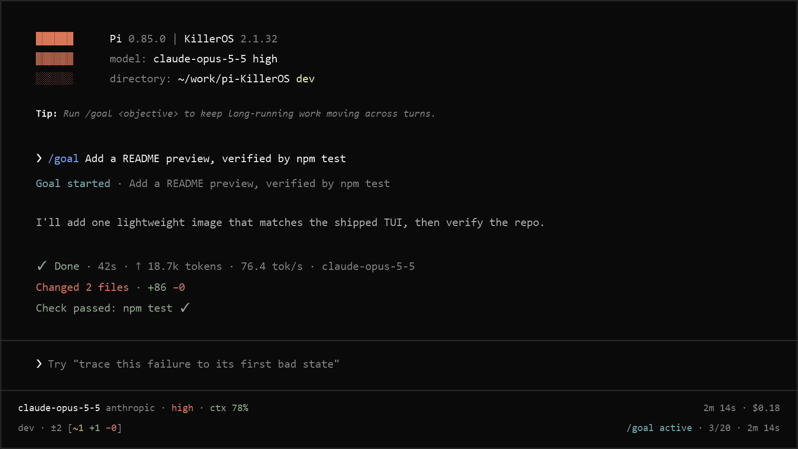

# KillerOS: Pi coding agent workflow toolkit

[](https://www.npmjs.com/package/killeros)
[](https://github.com/KyrosHendrix/pi-KillerOS/actions/workflows/ci.yml?query=branch%3Amain)
[](LICENSE)
[](#install)
[](https://hub.xerj.org/contributors/KyrosHendrix)

**Start a fresh session without starting the explanation over.**

A Windows terminal UI for the [Pi coding agent](https://github.com/earendil-works/pi), with session handoff, context management, OpenAI fast mode, and persistent goals.



## Your workflow, in the terminal

- **Session handoff.** `/handoff [focus]` creates a linked session with a continuation summary. You decide when to continue.
- **Context control.** `/auto-compact 20` triggers proactive compaction at 20% tokens remaining. The default is 15%.
- **OpenAI fast mode.** `/codex-fast` toggles priority-service requests for eligible OpenAI models without changing sampling settings.
- **Persistent goals.** `/goal <objective>` continues work across turns, compaction, and reloads. Pause, edit, or resume it.
- **Session visibility.** The footer shows model, remaining context, and goal status. Settled task receipts show duration and token usage.
- **Interactive questions.** The question tool offers single-select and multi-select answers inside the terminal.

## Install

KillerOS supports Windows only. Requires native Windows Node.js 26.13.0 or later within Node 26 and Pi 1.6.0 or later below 2.0.0. Users on older Node or Pi versions must upgrade. For a managed Pi installation, run `pi update` and check the version with `pi --version`.

```bash
pi install npm:killeros
pi
```

Run `/login` if needed, then start a conversation.

<details>
<summary>GitHub install and version pinning</summary>

- GitHub: `pi install git:github.com/KyrosHendrix/pi-KillerOS`.
- Pin a version: `npm:killeros@4.1.1` or `git:github.com/KyrosHendrix/pi-KillerOS@v4.1.1`.
- Add `-l` for a project-only install.

</details>

## Try it

Start a linked session from an idle saved conversation with no active goal:

```text
/handoff Focus next on implementing the agreed plan
```

Or give the agent a checkable goal:

```text
/goal Create `./summary.md` describing this repository's entry points, verified against the source files
```

<details>
<summary>All commands</summary>

```text
/handoff [focus]          Carry context into a linked session
/codex-fast [status]      Toggle or report priority service
/auto-compact [status|on|off|<percent>]
/goal                    View the current goal
/goal <objective>        Set an objective
/goal edit <objective>   Update an active or paused goal
/goal pause              Stop automatic continuation
/goal resume             Resume automatic continuation
/goal clear              Remove the current goal
/notification            Configure the completion sound
/new                     Start a new session using Pi's native command
/exit                    Quit Pi
```

</details>

## Before you run

- Model requests cost money. Goals can make repeated requests; OpenAI priority service can cost more and is not guaranteed.
- Review results and handoff summaries. Secret detection is incomplete; source context reaches your configured provider.
- Extensions run with your permissions. Review project hooks before granting trust.
- Questions require TUI mode. RPC supports goals and proactive compaction. Print and JSON modes support neither.

<details>
<summary>Goal limits, handoff behavior, and compaction</summary>

- Goals get 20 turns. Resume an exhausted goal to grant another 20. Work stops on completion, a blocker, or a pause.
- For supported single-file objectives such as the quoted `Create` example above, KillerOS requires the file to exist, or its content to change if it already existed. Multiple distinct file targets do not receive single-file proof. This does not prove every natural-language requirement. Saved goals without file proof keep that contract until you edit or replace the objective.
- `/handoff` requires an idle saved session with no active goal. It saves a structured continuation summary, not the full transcript. The current saved objective and status become context in the linked child; no goal or agent turn starts automatically.
- Missing or changed goal details, committed navigation, reload, or session replacement invalidate a pending handoff. Cancelled and no-op navigation preserve valid work.
- Handoff rejects recognized credentials in generated output, including password assignments in Markdown blockquotes and tables, and names the kind of match without showing it. It cannot detect every secret or redact source context before it reaches your provider.
- Compaction triggers by default at 15% tokens remaining. Turning KillerOS compaction off doesn't disable Pi's own compaction.
- Fast mode's footer label doesn't confirm OpenAI accepted the priority tier or guarantee faster responses.

</details>

### Goals in Pi RPC hosts

Use a saved Pi session with KillerOS enabled. In T3 Code, load KillerOS in the Pi provider and enter `/goal` commands in the composer. T3 Code can show the live goal in the Pi extension status above the composer.

#### Discover and control a goal

1. Send `{"type":"get_commands"}`. Check `data.commands` for `name: "goal"` and `source: "extension"`.
2. Send a command with `prompt`, for example `{"type":"prompt","message":"/goal Review the release notes"}`. Send `/goal` to inspect, `/goal edit <objective>` to edit an active or paused goal, and `/goal pause`, `/goal resume`, or `/goal clear` to control it.
3. If Pi sends an `extension_ui_request` with `method: "confirm"`, show it to the user. Send an `extension_ui_response` with the same `id` and the user's `confirmed` boolean, or `cancelled: true` if they dismiss it.

A `prompt` response with `data.disposition: "handled"` means Pi ran the command handler. Read the goal entry stream and `notify` events for the outcome. For example, `/goal resume` in an empty session returns `handled`, sends `No goal is set`, and starts zero turns.

#### Track and recover the saved goal

Pi sends new goal entries as `entry_appended` events. Read the event's `entry` when `type` is `custom` and `customType` is `killeros-goal`. Hosts use the following version 1 `entry.data` fields.

| Field     | Meaning                                                                                                                                                                                |
| --------- | -------------------------------------------------------------------------------------------------------------------------------------------------------------------------------------- |
| `version` | The record format version, currently `1`.                                                                                                                                              |
| `event`   | A string that names the reason Pi appended the record, such as `set`, `edit`, `pause`, `resume`, `blocked`, `complete`, or `clear`.                                                    |
| `state`   | The saved state after the event. Read `objective` as text, `status` as `active`, `paused`, `blocked`, or `complete`, and `turns` as a non-negative integer. A clear has `state: null`. |

On reconnect and after committed navigation, use `get_state` to identify the session by `data.sessionId`, then request `get_entries` for that session. Index `data.entries` by `id`. Start at `data.leafId` and follow `parentId` until you find the first `killeros-goal` entry or reach the root. That first entry gives the saved goal, even if a different branch has a newer entry. A clear or the absence of a goal entry means the branch has no saved goal. If the first goal entry uses an unsupported version, treat its state as unavailable and stop the search.

Scope cached entries to the session ID. If you use `get_entries` with a `since` cursor, merge the returned entries with your cache and use the returned `leafId`. Request the full entry list if an ancestor is missing. For a supported version, use `state` even if the event name is unfamiliar.

#### Display the live goal

Listen for `extension_ui_request` events with `method: "setStatus"` and `statusKey: "killeros-goal"`. Keep one label with that key for the current session. Replace it with `statusText`, for example `Goal paused · Review the release notes`. If Pi omits `statusText`, remove the label. These events require no reply.

The label follows the live goal when Pi opens or reloads a session, changes branches, or updates the goal. The live goal can differ from the saved goal when a write fails. Display the label as text and use the versioned entries for saved state.

<details>
<summary>Project hooks and personal instructions</summary>

Both features work only in a project you trust. KillerOS ignores them elsewhere and warns about ignored hooks.

Project hooks run shell commands on Pi events. Put them in `.pi/killeros-hooks.json` inside the project, in a file of at most 64 KiB:

```json
{
  "hooks": {
    "tool_call": [
      { "matcher": "^bash$", "command": "node scripts/check-command.js" }
    ],
    "tool_result": [
      {
        "matcher": "^(write|edit)$",
        "command": "npm run lint --silent",
        "timeoutMs": 60000
      }
    ],
    "agent_settled": [{ "command": "npm run format --silent" }]
  }
}
```

- `command` is required and runs in the project folder. `timeoutMs` is optional, from 1 to 300000, and defaults to 30000.
- `matcher` is an optional regular expression tested against the tool name. Omit it or use `"*"` to match every tool. It is valid only for `tool_call` and `tool_result`.
- A `tool_call` hook that exits with a nonzero code, or times out, blocks that tool call and shows its output. A failing `tool_result` or `agent_settled` hook is reported and blocks nothing.
- Each hook receives `KILLEROS_EVENT`, `KILLEROS_TOOL`, and `KILLEROS_PAYLOAD`. The payload is JSON: the tool input for `tool_call`, and `{ "input", "isError" }` for `tool_result`. A payload over 8000 characters arrives as a truncated preview.
- `agent_settled` hooks run after KillerOS saves the change receipt and plays the completion sound, so files a hook edits are not counted as the agent's changes. The next goal turn waits for these hooks to finish.

Personal instructions are private additions to the system prompt. KillerOS appends `AGENTS.local.md` from the project folder, up to 32 KiB. If the file holds a single `@path` line, KillerOS appends that file in its place. The path must point inside Pi's agent directory and may start with `~/`. Keep `AGENTS.local.md` out of version control.

</details>

<details>
<summary>Pi compatibility and settings</summary>

- KillerOS leaves Pi's `tuiMode` and `quietStartup` preferences unchanged. Pi defaults to fullscreen. Use `--tui-mode regular` or `"tuiMode": "regular"` for terminal-owned scrollback. Your keybindings still apply.
- Settings live in `%USERPROFILE%\.pi\agent\killeros.json`. The compaction defaults are `"autoCompaction": { "enabled": true, "percentRemaining": 15 }`. Fast mode isn't persisted.
- `"handoffMaxTokens"` in `killeros.json` sets the output budget for a `/handoff` summary. It must be a positive integer and defaults to 8192. Lower it when `/handoff` reports that the session lacks context space.
- Completion sounds are off by default. The tab-title indicator requires a Nerd Font.
- Pi's native `--tools` and `--exclude-tools` support `*` patterns. Quote patterns such as `"killeros_*"` so the shell does not expand them. An explicit allowlist must include `question` for questions and permit `killeros_goal_update` for goals. Excluding the goal tool pauses goals. Use `--exclude-tools` rather than `-name` modifiers. See [tool selection](https://github.com/earendil-works/pi/blob/main/packages/coding-agent/docs/cli.md#tools).
- In Pi codemode, `tools.read()` returns an image block for images that you can pass to `image()`. See [codemode](https://github.com/earendil-works/pi/blob/main/packages/coding-agent/docs/codemode.md#call-tools).
- Use `/thinking` and `samplingParamsByThinkingLevel` for [native sampling](https://github.com/earendil-works/pi/blob/main/packages/coding-agent/docs/models.md#configure-sampling-by-thinking-level). Use `.pi/mcp.json` for [trusted project MCP overrides](https://github.com/earendil-works/pi/blob/main/packages/coding-agent/docs/mcp.md#configure-servers).
- A nonempty `--tools` list with no `mcp__` entry preserves MCP tool availability. For example, `--tools codemode` does not disable MCP connections. Use `--no-mcp` to disable MCP connections. See [MCP tool exposure](https://github.com/earendil-works/pi/blob/main/packages/coding-agent/docs/mcp.md#control-tool-exposure).

</details>

<details>
<summary>Contributing and releases</summary>

## Contributing

Use Node.js 26.13.0, pinned in `.node-version`, and Bun canary for development. Install dependencies with `bun install --frozen-lockfile --ignore-scripts`. Run the checkout with `npx pi -e .` after disabling any installed copy.

Run `npm run check` or run its steps individually with `bun check --no-script`, `bun lint --no-script --type-aware --max-warnings=0 .`, and `bun fmt --no-script --check`. Run `npm run test:changed` for tests reachable from your local changes. The suite runner uses `bun test` for supported tests and Node for tests that need its runtime. There is no build step.

Open a pull request or dispatch CI manually to check a development branch. CI plans Windows test shards using recorded test times and runs checks in parallel. PRs normally run tests reachable from the diff against the merge commit's first parent. Changes to shared test inputs trigger the full suite. Main pushes, scheduled runs, and manual runs default to the full suite. When the latest compatible Pi packages differ from the lockfile, CI also checks and tests that set.

A successful same-repository PR into `main` can publish a `tested-full-tree-v2` artifact after the full suite passes. A push to `main` can reuse that run if CI verifies the merged tree and the exact Pi package versions. If the lookup fails or any field differs, CI runs the checks. CodeQL runs in a separate workflow with the same triggers.

### Release process

Prepare releases on `dev`, update package versions and changelog, and open a PR into `main`. Wait for required checks and review, then use a merge commit. CI and CodeQL must both pass for the same commit on `main` before publication. Do not push version tags manually. Wait for the automated sync back to `dev` before advancing it.

</details>

[Report a bug](https://github.com/KyrosHendrix/pi-KillerOS/issues) · [Changelog](CHANGELOG.md) · [MIT license](LICENSE)
